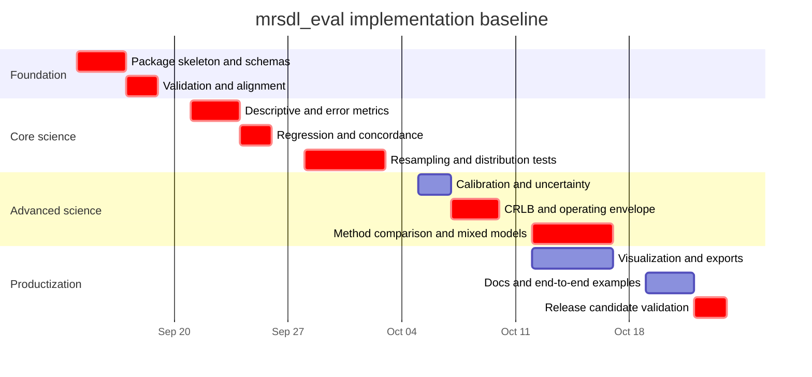
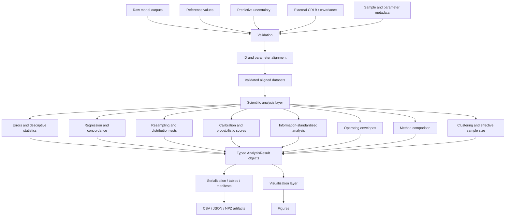
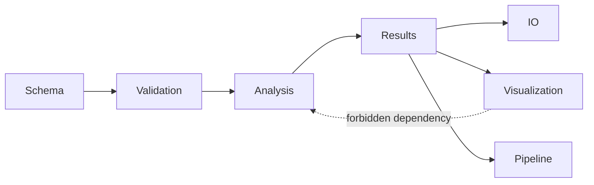

# LIBRARY_IMPLEMENTATION_SPEC.md

## Executive summary

This document is the implementation handover for a **pip-installable Python scientific-analysis and visualization library for evaluating fitted MRS/metabolite-estimation models**, derived from the supplied manuscript, bibliography, figure inventory, and the implementation requirements provided with the project.

The central architectural rule is non-negotiable:

> **The scientific analysis layer computes all metrics, statistical tests, confidence intervals, uncertainty diagnostics, agreement analyses, operating envelopes, and standardized quantities. The visualization layer receives those precomputed result objects and renders them without recomputing scientific quantities.**

This separation is essential for reproducibility: the number reported in a table, serialized to disk, or plotted on a figure must come from the same analysis result object, rather than from parallel implementations embedded in plotting functions.

The implementation should use mature scientific Python functionality where its definition exactly matches the required statistic. In particular, SciPy provides appropriate primitives for Pearson correlation, paired/independent permutation testing, and Theil–Sen regression; the latter must explicitly use `method="joint"` because that definition uses `median(y - slope*x)` for the intercept, matching the supplied manuscript rather than SciPy's other intercept convention. citeturn8search0turn8search2turn8search3 Statsmodels provides appropriate infrastructure for mixed-effects fitting, cluster-robust covariance, and multiplicity correction, but it should **not** be assumed to solve the manuscript's observation-specific errors-in-variables mixed model automatically. citeturn9search0turn9search1turn9search2turn9search5

Several manuscript formulas require unusually careful treatment because their displayed equations and surrounding prose are not entirely consistent. The implementation must therefore preserve **manuscript-literal definitions for reproducibility** while separately exposing corrected or interpretation-based alternatives where justified. In particular:

| Topic | Implementation decision |
|---|---|
| Power SNR | Implement the RMS-power expression from the first displayed definition. Treat the manuscript's expanded second equality as a typesetting discrepancy rather than copying its apparent square-root-of-magnitude term. |
| Robust variance | Preserve the manuscript quantity `median((x - median(x))²)` but name it explicitly as a raw median squared deviation rather than presenting it as the usual normal-consistent robust variance. |
| MAPE | Preserve the manuscript denominator convention in a reproduction mode; provide an explicitly named absolute-reference variant separately rather than silently changing the paper. |
| Bias-corrected MAPE | Implement the displayed literal expression and the prose-implied absolute centered-percent-error statistic as two different definitions. |
| Median absolute percentage error | Preserve the displayed manuscript form for reproduction while providing the conventional `100 × median(...)` interpretation separately because the displayed extra `1/N` factor is inconsistent with a median. |
| \(R^2\) | Use the standard squared total sum of squares. The manuscript's unsquared `SS_tot` expression is inconsistent with its own explanation and with the definition of \(R^2\). |
| New concise score | Implement the manuscript-defined \(r^3 := r\,\max(0,R^2)\) literally as a named composite score; do not calculate `r**3`. |
| Robust CCC | Treat as an experimental manuscript statistic, not as a drop-in statistically validated replacement for Lin's CCC. |
| ECWAS/Funato extension | Keep the manuscript's max-shape construction distinguishable from the published families of adaptive/max-type tests; do not mislabel a manuscript-specific simplification as a validated published Funato procedure. Kössler and Mukherjee's original work concerns simultaneous distribution-free location/scale/Lehmann-alternative testing, while Funato et al. later develop additional adaptive and max-type procedures. citeturn12search0turn11search0turn12search3 |
| Deming variance ratio | Never expose an ambiguous naked `lambda` as the preferred public interface. Request named reference and test-method error variances and derive the ratio under an explicit convention. The importance of correctly specifying the error-variance ratio is established in the Deming-regression literature. citeturn10search2turn10search3 |
| CRLB | Accept as **external data only by default**. Do not calculate CRLBs inside this library. Require explicit representation metadata such as variance, standard deviation, percent standard deviation, or covariance. |
| Visualization | Plots accept analysis result objects. Raw arrays belong in analysis APIs, not scientific plotting APIs. |

Lin's original concordance correlation coefficient is an agreement measure relative to the 45-degree equality line rather than merely a correlation coefficient, and should therefore be implemented independently of Pearson's \(r\). citeturn10search4 Bland–Altman analysis likewise exists specifically because correlation alone is inappropriate for assessing agreement between measurement methods. citeturn10search0turn10search19 Passing–Bablok should be implemented and validated as a genuine method-comparison regression, not approximated by ordinary least squares. citeturn10search7turn10search17

The project should be distributed using modern `pyproject.toml` packaging. PyPA documents `pyproject.toml` as the standard location for build-system, project, and tool configuration and recommends building distributions through the standard build frontend rather than invoking `setup.py` directly. Both source distributions and wheels should be tested. citeturn7search10turn7search6turn7search3turn7search7turn7search11 Releases should use PyPI Trusted Publishing/OIDC rather than long-lived PyPI API tokens wherever the repository is hosted on a supported CI provider such as GitHub Actions; PyPI's documentation specifically describes short-lived publishing credentials and the workflow protections required around them. citeturn7search0turn7search1turn7search9

**Implementation readiness:** the scientific contract, package boundaries, result schemas, failure semantics, testing requirements, release process, and implementation sequence are specified below. Claude Code should be able to implement from this document without inventing the project's scientific behavior. Where the source manuscript itself leaves a method underdetermined, this specification chooses a conservative API that exposes the ambiguity rather than hiding it.

**Project-state baseline as of September 11, 2026:** research/specification is complete enough to begin implementation. No claim is made here that the Python package, CI workflows, releases, or manuscript figures have already been implemented. Exact pixel-for-pixel reproduction of historical figures is also outside the evidence available from the supplied LaTeX captions alone; the scientific transformations and plot semantics are specified, but original plotting source, exact colors, typography, dimensions, and undocumented aesthetic adjustments were not supplied.

## Purpose, scope, stakeholders, status, and delivery timeline

**Purpose.** The library shall turn model outputs, ground/reference values, uncertainty estimates, metadata, and externally supplied information bounds into reproducible scientific analyses. It must support manuscript replication while also providing safer, explicit interfaces for edge cases that the manuscript equations do not spell out.

The recommended working import name is:

```text
mrsdl_eval
```

The distribution name may be:

```text
mrsdl-eval
```

If an existing repository already declares a package name, Claude Code should retain that established name rather than performing a gratuitous rename. A public package name should be considered frozen after the first public release.

**Primary scope**

The initial production-capable library covers:

1. input validation, parameter metadata, sample/model alignment, missingness and exclusion reporting;
2. SNR calculations where the necessary signal/noise data are supplied;
3. effective sample size and clustering diagnostics;
4. descriptive and error metrics;
5. regression and concordance;
6. bootstrap and permutation inference;
7. distributional-comparison statistics;
8. calibration and probabilistic-score evaluation from externally generated predictive distributions;
9. external-CRLB/information-standardized analysis;
10. robust operating-envelope estimation;
11. uncertainty-quality and out-of-distribution summaries;
12. Bland–Altman, Passing–Bablok, Deming, and supported mixed-effects method comparisons;
13. manuscript-oriented scientific visualization;
14. serializable result/provenance artifacts;
15. a batch runner suitable for terminal, IDE, notebook, and CI use.

It does **not** train neural networks, fit the original spectroscopy models, generate CRLBs by default, silently impute missing scientific observations, infer units from magnitudes, or embed model-specific training code.

**Feature classifications**

The following terms are normative throughout implementation:

| Classification | Meaning |
|---|---|
| **MANUSCRIPT REQUIRED** | Needed to reproduce or operationalize an analysis explicitly defined or called for in the supplied manuscript. |
| **CORE INFRASTRUCTURE** | Necessary to make manuscript analyses reliable, typed, auditable, aligned, and reproducible. |
| **RECOMMENDED EXTENSION** | Scientifically useful addition that must remain distinguishishable from manuscript reproduction. |
| **DEVELOPMENT/OPERATIONS REQUIREMENT** | Packaging, testing, CI, release, documentation, security, or operational capability. |

**Audience and stakeholders**

| Stakeholder / role | Responsibility | Decision authority |
|---|---|---|
| Scientific Maintainer | Scientific definitions, manuscript fidelity, acceptance of discrepancies | Final authority over metric definitions |
| Implementation Lead / Claude Code | Package architecture, implementation, tests, documentation, CI | Engineering choices inside this specification |
| Statistical Reviewer | Review inferential procedures, mixed models, resampling, equivalence/agreement analyses | Statistical sign-off |
| Release Maintainer / Repository Admin | Branch protection, environments, package publication | Release and credential administration |
| Downstream Researcher | Supplies model outputs/reference data and interprets analysis | Dataset-specific scientific choices |
| Data Steward | Determines whether sample IDs/data are sensitive and sets retention policy | Data-governance decisions |

No personal names or contact details were supplied. The implementation must therefore use role-based ownership in documentation and resolve actual maintainers from repository metadata such as `CODEOWNERS`, package metadata, or the project's governance documentation.

**Project status**

| Workstream | Status at handover | Owner | Priority | Target | Blocking issue |
|---|---|---|---|---|---|
| Manuscript/equation inventory | Complete | Scientific Maintainer | P0 | Done | None |
| Scientific-definition reconciliation | Complete for implementation | Scientific Maintainer | P0 | Done | Some manuscript discrepancies must stay explicit |
| Package/API contract | Specified here | Implementation Lead | P0 | Week 1 | None |
| Validation/alignment infrastructure | Not implemented | Implementation Lead | P0 | Sep 18, 2026 | None |
| Core descriptive/error/regression analysis | Not implemented | Implementation Lead | P0 | Sep 25, 2026 | None |
| Agreement/distribution/resampling | Not implemented | Implementation Lead | P0 | Oct 2, 2026 | None |
| CRLB/uncertainty/operating envelope | Not implemented | Implementation Lead | P0 | Oct 9, 2026 | External test fixtures required |
| Method comparison/mixed effects | Not implemented | Implementation Lead + Statistical Reviewer | P1 | Oct 16, 2026 | Complex Test 3 needs custom treatment |
| Visualization layer | Not implemented | Implementation Lead | P1 | Oct 16, 2026 | Must follow analysis APIs |
| Batch runner/export/provenance | Not implemented | Implementation Lead | P1 | Oct 16, 2026 | None |
| Documentation/example datasets | Not implemented | Implementation Lead | P1 | Oct 21, 2026 | Need redistributable synthetic fixtures |
| Package/release CI | Not implemented | Release Maintainer | P0 | Oct 21, 2026 | Repository permissions |
| Scientific acceptance/release candidate | Pending implementation | Scientific + Statistical Reviewer | P0 | Oct 23, 2026 | All acceptance gates |

The dates above are a **baseline implementation schedule beginning Monday, September 14, 2026**, not evidence of an externally committed contractual delivery date.



**Responsibility split**

| Concern | Claude Code / Implementation Lead | Scientific Maintainer | Statistical Reviewer | Release Maintainer |
|---|---|---|---|---|
| API/data classes | Responsible | Consulted | Consulted | Informed |
| Formula implementation | Responsible | Accountable | Reviewer | Informed |
| Manuscript discrepancies | Documents both definitions | Accountable | Reviewer | Informed |
| Unit/property tests | Responsible | Reviews scientific fixtures | Reviews inference fixtures | Informed |
| CI | Responsible | Informed | Informed | Accountable |
| Release credentials | No direct secret handling | None | None | Accountable |
| PyPI publication | Builds/test artifacts | Approves scientific release | Signs statistical acceptance | Publishes |
| Data retention | Implements local/offline defaults | Consulted | Informed | Consulted |
| Clinical/regulatory interpretation | Must not claim compliance | Accountable externally | Consulted | Informed |

## Scientific contract and method inventory

**Canonical input representation**

The principal fitted-parameter matrix is:

```text
values.shape == (n_samples, n_fit_parameters)
```

Every column must be described by ordered metadata. A common ordering expected by the supplied manuscript is:

1. metabolite concentrations;
2. Lorentzian line-shape parameters;
3. Gaussian line-shape parameter(s), either global or metabolite-specific with optional macromolecule terms;
4. frequency shifts per fitted basis function;
5. SNR;
6. zero-order phase;
7. first-order phase;
8. optional baseline spline coefficients.

The library must **not** assume that every dataset contains every category or that column order can be inferred from column count. `ParameterSpec` metadata is authoritative.

A minimum parameter descriptor is:

```python
@dataclass(frozen=True)
class ParameterSpec:
    name: str
    role: ParameterRole
    unit: str | None
    basis_name: str | None = None
    metabolite: str | None = None
    component_index: int | None = None
```

A dataset must additionally provide stable sample identity:

```python
@dataclass(frozen=True)
class ObservationSet:
    sample_ids: NDArray[str]
    values: NDArray[np.float64]
    parameters: ParameterSchema
    subject_ids: NDArray[str] | None = None
    cluster_ids: NDArray[str] | None = None
    model_id: str | None = None
    metadata: Mapping[str, Any] = field(default_factory=dict)
```

Row position is never a valid pairing contract by itself.

**Alignment contract**

All comparisons must pass through a central alignment routine:

```python
align_observations(
    reference: ObservationSet,
    candidate: ObservationSet,
    *,
    pairing: Literal["paired", "independent"],
    duplicate_policy: Literal["error", "first", "aggregate"] = "error",
) -> AlignedComparison
```

For paired analyses, default behavior is intersection by explicit sample ID followed by deterministic reordering. Duplicates must fail unless an explicit policy has been selected.

`AlignmentReport` must contain at least:

```text
matched_ids
only_in_reference
only_in_candidate
duplicate_ids_reference
duplicate_ids_candidate
excluded_ids
exclusion_reasons
n_reference_input
n_candidate_input
n_final
pairing_status
reorder_occurred
```

**Universal result semantics**

Every scientific result is wrapped in a common result envelope:

```python
class ResultStatus(str, Enum):
    VALID = "valid"
    UNDEFINED = "undefined"
    INSUFFICIENT_DATA = "insufficient_data"
    INVALID_INPUT = "invalid_input"
    FAILED = "failed"
    NOT_REQUESTED = "not_requested"
```

The result base should contain:

```python
@dataclass(frozen=True)
class AnalysisMeta:
    status: ResultStatus
    n_total: int
    n_used: int
    n_omitted: int
    included_ids: tuple[str, ...]
    excluded_ids: tuple[str, ...]
    exclusion_reasons: Mapping[str, int]
    warnings: tuple[str, ...]
    method: str
    method_version: str
    configuration: Mapping[str, Any]
    random_seed: int | None
```

No routine may silently replace `NaN`, infinity, missing samples, zero denominators, singular covariance matrices, or failed fits with plausible-looking values.

Invalid values may be omitted only through a documented mask, with the omissions present in `AnalysisMeta`.

**Near-zero policy**

Scale-sensitive denominators need an explicit test. A recommended default for a variance-like quantity \(v\) is:

\[
v \le \max\left(\epsilon_{\mathrm{abs}},
\epsilon_{\mathrm{rel}}\max(1,s^2)\right),
\]

where \(s\) is an appropriate data scale and the default float64 relative tolerance is approximately \(10^{-12}\). The exact threshold used must be returned in result metadata.

Do not add a hidden epsilon to scientific denominators. Adding `1e-8`, for example, to make CV, MAPE, CCC, Deming, covariance inversions, or normalization "work" changes the statistic.

**Core descriptive and error statistics**

| Method | Required definition / implementation rule | Classification |
|---|---|---|
| Mean | Arithmetic mean | MANUSCRIPT REQUIRED |
| Median | Sample median | MANUSCRIPT REQUIRED |
| Sample variance | \(\sum(x-\bar x)^2/(N-1)\) | MANUSCRIPT REQUIRED |
| Raw robust variance | \(\operatorname{median}[(x-\operatorname{median}x)^2]\) | MANUSCRIPT REQUIRED |
| Raw robust SD | Square root of preceding statistic | CORE INFRASTRUCTURE |
| IQR | \(Q_{0.75}-Q_{0.25}\), quantile method recorded | MANUSCRIPT REQUIRED |
| Tukey outlier rule | \(Q_1-1.5IQR\) to \(Q_3+1.5IQR\) | MANUSCRIPT REQUIRED |
| CV | SD / mean; undefined for effectively zero mean | MANUSCRIPT REQUIRED |
| Robust CV | raw robust SD / median | MANUSCRIPT REQUIRED |
| MPE | \(100\,\operatorname{mean}[(\hat y-y)/y]\) | MANUSCRIPT REQUIRED |
| MePE | \(100\,\operatorname{median}[(\hat y-y)/y]\) | MANUSCRIPT REQUIRED |
| MAPE literal | Preserve manuscript displayed denominator convention | MANUSCRIPT REQUIRED |
| Absolute-reference MAPE | \(100\,\operatorname{mean}(|\hat y-y|/|y|)\) | RECOMMENDED EXTENSION |
| Bias-corrected MAPE literal | Preserve displayed paper equation | MANUSCRIPT REQUIRED |
| Mean absolute percent deviation about bias | Absolute centered-percent-error interpretation | RECOMMENDED EXTENSION |
| MeAPE literal | Preserve displayed manuscript expression | MANUSCRIPT REQUIRED |
| Conventional MeAPE | \(100\,\operatorname{median}(|\hat y-y|/|y|)\) | RECOMMENDED EXTENSION |
| RMSE | \(\sqrt{\operatorname{mean}[(\hat y-y)^2]}\) | MANUSCRIPT REQUIRED |
| Root median squared error | \(\sqrt{\operatorname{median}[(\hat y-y)^2]}\) | MANUSCRIPT REQUIRED |

Percentage-error APIs must have an explicit denominator policy and zero-reference behavior. The recommended scientific default is:

```text
zero_reference_policy = "omit_and_report"
```

with alternatives such as `"error"` available. No epsilon substitution.

**SNR**

The supplied manuscript defines metabolite spectral SNR as:

\[
\mathrm{mSNR}_S(n)
=
\frac{\max_\omega \Re(x_n(\omega))}
{\sigma_{\text{noise}}}.
\]

Power SNR should implement the first RMS-power expression supplied by the manuscript:

\[
\mathrm{mSNR}_P
=
\sqrt{
\frac{1}{\sigma_{\text{noise}}^2}
\frac{1}{N_s}
\sum_k |y[k]|^2
}.
\]

The manuscript's subsequently expanded equality appears inconsistent with this RMS expression because of the placement of a square root. `power_snr()` therefore follows the RMS definition and records:

```text
definition = "manuscript_first_equality_rms_power"
```

Noise scale may come from a pure-noise tail of the FID or a designated metabolite-free spectral region. The library must not decide a spectral noise region from undocumented hard-coded frequency indices.

Support both global SNR and metabolite-specific SNR, but keep them semantically distinct.

**Regression and association**

Pearson correlation should wrap SciPy's tested implementation rather than reproduce inference code locally. SciPy documents its current `pearsonr` implementation and the associated significance calculation. citeturn8search3

The manuscript's median-centered correlation is:

\[
\tilde r =
\frac{\sum_i
(x_i-\tilde x)(y_i-\tilde y)}
{\sqrt{\sum_i(x_i-\tilde x)^2}
 \sqrt{\sum_i(y_i-\tilde y)^2}}.
\]

Implement it under an explicit name such as:

```python
median_centered_correlation(...)
```

Do not attach Pearson's parametric \(p\)-value to this statistic.

For direct prediction evaluation:

\[
R^2
=
1-
\frac{\sum_i(y_i-\hat y_i)^2}
{\sum_i(y_i-\bar y)^2}.
\]

The denominator is squared despite the apparent manuscript typesetting omission. Direct \(R^2\) may legitimately be negative and must not be clipped except inside a separate composite statistic that explicitly calls for clipping.

Adjusted \(R^2\):

\[
\bar R^2 =
1-(1-R^2)\frac{n-1}{n-p-1}.
\]

Here \(p\) is the number of predictors in the auxiliary regression being evaluated, **not** the number of trainable neural-network parameters.

The original concise score used in the referenced MRS work is based on regression slope multiplied by \(R^2\); the source article reports slope/intercept/\(R^2\), concise scores of \(aR^2\), and RMSE. citeturn13search0

The manuscript's new score:

\[
r^3_{\mathrm{concise}}
\equiv
r \max(0,R^2_{\mathrm{direct}})
\]

must be named as a manuscript composite. The implementation must never replace it with ordinary mathematical \(r^3\).

Theil–Sen shall wrap:

```python
scipy.stats.theilslopes(..., method="joint")
```

because SciPy documents the joint intercept as the median of `y - slope*x`, matching the manuscript specification. citeturn8search0

**Lin concordance correlation coefficient**

Implement from first principles:

\[
\rho_c
=
\frac{2r\sigma_x\sigma_y}
{\sigma_x^2+\sigma_y^2+(\mu_x-\mu_y)^2}.
\]

Use the variance convention required by Lin's formula consistently, and explicitly test equality, translation bias, and scale bias. Lin's original article introduces CCC to evaluate agreement/reproducibility relative to the equality line. citeturn10search4

The manuscript's robust counterpart replaces location/scale components with median-based analogues while retaining correlation. It must carry:

```text
experimental = true
method = "manuscript_robust_ccc"
```

It must not be marketed simply as "Lin CCC."

**Probabilistic predictions and NLPD**

For a univariate Gaussian predictive distribution:

\[
\operatorname{NLPD}
=
\frac1N
\sum_i
\frac12
\left[
\log \sigma_i^2
+
\frac{(y_i-\mu_i)^2}{\sigma_i^2}
+
\log(2\pi)
\right].
\]

Requirements:

- predictive variance must be finite and strictly positive;
- zero or negative variance is `invalid_input`;
- an optional variance floor is a separately configured numerical policy, disabled in strict reproduction mode and recorded whenever applied;
- train/development-set standardization parameters must be fixed before test evaluation;
- if \(y'=(y-c)/s\), predictive variance transforms as \(\sigma'^2=\sigma^2/s^2\);
- report metabolite-wise marginal NLPD and equal-weight macro NLPD;
- a full-covariance joint Gaussian implementation should use matrix factorization/linear solves and log-determinants, not an explicit matrix inverse.

NLPD does not replace calibration diagnostics.

**Error consistency**

For manuscript residuals \(r_i,r_j\), implement:

\[
\rho_{\mathrm{EC}}
=
\frac1N
\sum_n
\operatorname{sign}(r_{i,n}r_{j,n})
\frac{
\left|\;|r_{i,n}|-|r_{j,n}|\;\right|
}{
|r_{i,n}|+|r_{j,n}|
}.
\]

If both residuals are exactly zero, define that observation's contribution as zero and increment a `zero_zero_pairs` diagnostic count.

A single aggregate close to zero is not sufficient to distinguish genuinely similar errors from positive/negative cancellation. Return the per-observation contributions or at least contribution-distribution summaries as part of the analysis result.

**Distributional similarity**

The manuscript intentionally considers an **independent two-sample** comparison in the simulation setting when training ground truth and test-model outputs represent samples from the same target distribution. This design choice must be explicit:

```python
comparison_design: Literal["independent", "paired"]
```

Never change from paired to independent because a test implementation is more convenient.

Implement the manuscript ECWAS family as individually named methods rather than one opaque routine. The Kössler–Mukherjee work develops distribution-free simultaneous tests involving location, scale, and Lehmann-type alternatives. citeturn12search0turn12search9 Funato et al. subsequently develop extended adaptive and max-type procedures. citeturn11search0turn12search3

Therefore use names such as:

```text
ecwas_kossler_mukherjee
ecwas_manuscript_max_shape
```

and store the exact component statistics in the result.

For tie-heavy/discrete data, favor permutation calibration of the composite statistic instead of pretending continuous-distribution asymptotics remain exact.

**Resampling**

Resampling must preserve the true independent unit. SciPy's permutation-test API explicitly distinguishes independent permutation, paired sample swapping, and paired-association permutations; wrappers should select the mode from the analysis design rather than from array shape. citeturn8search2

Rules:

- paired model comparisons resample paired vectors together;
- clustered observations resample independent subjects/clusters, carrying all dependent observations with that cluster;
- multimetabolite cluster bootstrap carries all metabolites for an independent cluster;
- seed/configuration is serialized;
- aggregation order is deterministic;
- default implementation may use 10,000 resamples, but this is a configurable engineering default rather than an immutable manuscript fact;
- return Monte Carlo/resample count and the exact inference method.

**Effective sample size and clustering**

For a one-way random-effects model per metabolite:

\[
d_{s,n}=\mu+w_s+\nu_{s,n},
\]

derive between- and within-cluster variance using REML, then:

\[
\rho=
\frac{\sigma_w^2}
{\sigma_w^2+\sigma_\nu^2},
\]

\[
D_\mathrm{eff}=1+\rho(\bar n-1),
\qquad
N_\mathrm{eff}
=
\frac{N_{\mathrm{total}}}{D_\mathrm{eff}}.
\]

The calculation is per metabolite unless the caller deliberately supplies another grouping. For cross-classified subject/metabolite dependence, use the manuscript's cross-classified design rather than collapsing it into a one-way ICC.

Statsmodels' mixed-effects implementation supports REML fitting and structured group/random-effects models and is an appropriate reusable fitting engine where its likelihood matches the intended model. citeturn9search0turn9search1turn9search10turn9search14

**Calibration**

Calibration analysis accepts predictive distributions or precomputed probability/coverage quantities; it does not train the uncertainty model.

Support:

```text
nominal_coverage
empirical_coverage
absolute_calibration_gap
ECE
PIT/CDF values where supplied
```

The recalibration ideas referenced in the manuscript are consistent with the regression-calibration framework introduced by Kuleshov and colleagues, but recalibration itself should remain separate from assessing the originally supplied predictive distribution. citeturn11search1

**External CRLB contract**

CRLB data are external inputs.

```python
class UncertaintyRepresentation(str, Enum):
    VARIANCE = "variance"
    STD = "std"
    PERCENT_STD = "percent_std"
    COVARIANCE = "covariance"
```

The library must reject an uncertainty array for which this representation is absent.

For covariance \(C_{\mathrm{CRLB}}\):

\[
\sigma_{\mathrm{CRLB},m}
=
\sqrt{(C_{\mathrm{CRLB}})_{mm}}.
\]

Validation requires:

- finite values where used;
- nonnegative diagonal;
- symmetry within documented tolerance for covariance;
- unit compatibility;
- `% std` conversion only when a corresponding reference and an explicit percentage definition are supplied.

For multivariate standardized error:

\[
D^2 =
e^\top C_{\mathrm{CRLB}}^{-1}e,
\]

use Cholesky factorization or `solve`; do not explicitly form \(C^{-1}\).

A singular covariance is invalid in strict mode. A pseudoinverse may be enabled explicitly as an extension, in which case effective rank and tolerance are returned.

A biased or regularized estimator exhibiting empirical variance below a CRLB does **not** by itself prove that the bound has been violated. Bias, variance, and MSE must be reported separately.

The manuscript's per-observation information-standardized disagreement is:

\[
\epsilon_{i,n}
=
\frac{|\hat y_{i,n}-y^{\mathrm{ref}}_{i,n}|}
{\sigma_{\mathrm{CRLB},i,n}}.
\]

Under a zero-mean Gaussian error whose standard deviation equals the normalizing CRLB standard deviation, the expectation of the absolute standardized error is \(\sqrt{2/\pi}\), not 1. Consequently the software must not label `epsilon == 1` as a universal theoretical optimum.

**Robust operating envelope**

This should be treated as a first-class analysis rather than a plotting convenience.

For metabolite \(m\), define predicted-concentration bins \(B_{m,b}\), error tolerance \(\tau_m\), and information strata \(G_{m,g}\) derived from the externally supplied oracle uncertainty metric.

For each bin and information stratum:

\[
p_{m,b,g}
=
P(E_m \le \tau_m
\mid
\hat c_m\in B_{m,b},
\theta\in G_{m,g}).
\]

With \(S\) successes in \(N\) observations:

\[
\hat p = \frac SN.
\]

For simultaneous one-sided guarantees across \(G\) information strata, allocate:

\[
\alpha_g = \frac{\alpha}{G},
\]

and calculate a one-sided exact binomial/Clopper–Pearson lower limit:

\[
L_g =
\operatorname{Beta}^{-1}
(\alpha_g;S,N-S+1),
\]

with \(L_g=0\) when \(S=0\).

Then:

\[
L_{\mathrm{robust},m,b}
=
\min_g L_{m,b,g}.
\]

A concentration bin is inside the operating envelope when:

\[
L_{\mathrm{robust},m,b}\ge \gamma.
\]

Sparse strata are `insufficient_data`; they must not be interpolated away to make the operating envelope look larger.

The result object must retain:

```text
bin_edges
stratum_edges
successes
totals
raw_success_rate
lower_confidence_bound
robust_lower_bound
target_reliability
alpha
alpha_per_stratum
sufficient_data_mask
operating_bin_mask
```

**Uncertainty quality**

The manuscript's uncertainty/error association metric should be implemented directly and labeled as such. At minimum return the correlation between nonnegative prediction error and uncertainty per metabolite/output plus a macro aggregate.

Predictive marginal variance, predictive entropy, decomposed uncertainty, and spectral-component uncertainty must consume uncertainty components generated outside this package. The library evaluates and visualizes them; it does not silently construct Bayesian/posterior uncertainty.

**Method comparison**

Bland–Altman must calculate differences directly and should not substitute correlation, consistent with the motivation of the original method. citeturn10search0turn10search19

The manuscript mode should use the reference-method value on the horizontal axis. A configurable conventional mean-of-methods x-axis may be exposed separately.

At minimum:

```python
bland_altman(
    reference,
    test,
    *,
    x_axis="reference",
    location="mean",
    scale="sd",
    conditional=False,
)
```

For constant-variance normal differences:

\[
\widehat{\mathrm{bias}}
\pm 1.96\,\widehat{\mathrm{SD}}(d).
\]

For manuscript heteroscedastic limits:

\[
\widehat{\mathrm{bias}}(c)
\pm
1.96\,\widehat{\mathrm{SD}}(c).
\]

Because the manuscript specifies concentration-dependent bias/dispersion but does not uniquely determine every estimator used to fit those functions, the v1 API must require the conditional models to be explicit in metadata. The reference implementation should use transparent low-order parametric location/scale models and return fitted coefficients and diagnostics rather than concealing the modeling choice.

Passing–Bablok should be implemented from its pairwise-slope construction rather than approximated by Theil–Sen or OLS. Passing and Bablok's original method is specifically a robust nonparametric procedure for comparing two analytical methods. citeturn10search7turn10search14turn10search17

Given manuscript orientation with reference \(y\) and candidate \(x\):

\[
S_{ij}
=
\frac{x_j-x_i}{y_j-y_i},
\]

with zero reference differences excluded according to the method's rules. The manuscript's slope adjustment and intercept:

\[
\hat a
=
\operatorname{median}_i(x_i-\hat b y_i)
\]

must be implemented exactly in the manuscript-compatible variant. Published numerical examples should be regression fixtures.

For Deming regression, **do not request only `lambda` from normal users**. Use:

```python
deming(
    reference,
    test,
    *,
    reference_error_variance,
    test_error_variance,
    ...
)
```

and record:

```text
variance_ratio_value
variance_ratio_convention
reference_axis
test_axis
```

This avoids the numerator/denominator ambiguity present between different notational conventions and between portions of the supplied manuscript. Linnet's method-comparison work emphasizes that misspecifying the analytical-error ratio affects Deming regression, so silently assuming unity is scientifically unsafe. citeturn10search2turn10search3

When a synthetic reference is mathematically exact, a finite-error Deming model is generally unnecessary unless uncertainty was deliberately added to that reference.

For clustered inference, Statsmodels' cluster sandwich covariance implementation may be wrapped for supported linear-model cases, with the clustering unit explicitly named in provenance. citeturn9search5

Mixed-effects comparison Tests 1 and 2 can use `MixedLM` where the manuscript model maps to standard mixed-effects likelihoods. citeturn9search0turn9search1 The manuscript's third test combines method comparison, observation-specific errors-in-variables, and clustered/random effects; it should be implemented as its own statistical model or cluster bootstrap procedure rather than falsely represented as a stock `MixedLM` fit.

For the joint intercept/slope agreement null in Test 3, use simultaneous inference with the manuscript's familywise allocation, including the indicated split of a 5% global level into 2.5% component levels when reproducing that analysis.

**Equation-to-module traceability**

The supplied manuscript's equation labels should be wired to tests and implementation modules as follows:

| Supplied equation labels | Implementation target |
|---|---|
| 1–2 | `analysis.snr` |
| 3–10 | `analysis.sample_size`, `analysis.clustering` |
| 11–15 | `analysis.resampling` |
| 16–24 | `analysis.descriptive` |
| 25–32 | `analysis.errors` |
| 33–42 | `analysis.regression`, `analysis.agreement` |
| 43 | `analysis.probabilistic.nlpd` |
| 44 | `analysis.error_consistency` |
| 45–46 | `analysis.distribution` |
| 47–49 | `analysis.standardization` |
| 50–51 | `analysis.multivariate_agreement` |
| 52 | `analysis.calibration` |
| 53 | `analysis.information` |
| 54–55 | `analysis.uncertainty` |
| 56 | `analysis.method_comparison.bland_altman` |
| 57–59 | `analysis.method_comparison.passing_bablok` |
| 60–64 | `analysis.method_comparison.deming` |
| 65–66 | `analysis.information` |
| 67–69 | `analysis.cluster_inference` |
| 70–72 | `analysis.method_comparison.equivalence` |

The multivariate concordance work referenced by the manuscript has a primary publication describing concordance for multiple variables/methods. Its implementation should be treated separately from scalar Lin CCC and validated against the paper's defined estimator. citeturn11search2turn11search3

## Architecture, APIs, schemas, figures, and data lifecycle

**Package architecture**

The repository should use a `src/` layout:

```text
.
├── pyproject.toml
├── README.md
├── LICENSE
├── CHANGELOG.md
├── CITATION.cff
├── src/
│   └── mrsdl_eval/
│       ├── __init__.py
│       ├── schema.py
│       ├── alignment.py
│       ├── validation.py
│       ├── missingness.py
│       ├── exceptions.py
│       ├── _numerics.py
│       ├── analysis/
│       │   ├── descriptive.py
│       │   ├── errors.py
│       │   ├── regression.py
│       │   ├── agreement.py
│       │   ├── multivariate.py
│       │   ├── resampling.py
│       │   ├── distribution.py
│       │   ├── calibration.py
│       │   ├── probabilistic.py
│       │   ├── uncertainty.py
│       │   ├── information.py
│       │   ├── operating_envelope.py
│       │   ├── sample_size.py
│       │   ├── clustering.py
│       │   └── method_comparison.py
│       ├── viz/
│       │   ├── scatter.py
│       │   ├── heatmaps.py
│       │   ├── distributions.py
│       │   ├── calibration.py
│       │   ├── snr.py
│       │   ├── information.py
│       │   ├── uncertainty.py
│       │   └── agreement.py
│       ├── io/
│       │   ├── loaders.py
│       │   ├── exporters.py
│       │   └── manifest.py
│       └── pipeline/
│           ├── config.py
│           ├── runner.py
│           └── progress.py
├── tests/
│   ├── unit/
│   ├── property/
│   ├── reference/
│   ├── adversarial/
│   ├── integration/
│   └── plots/
├── docs/
├── examples/
└── .github/
    └── workflows/
```

Do **not** add a runtime `repository` package for Git operations. Git workflow belongs to development and CI, not to the scientific package.



The key dependency direction is:



The dotted edge represents a prohibited relationship: `viz` modules must not invoke scientific metric/test implementations.

**Recommended public API**

Keep the top-level namespace deliberately small:

```python
from mrsdl_eval import (
    ObservationSet,
    ParameterSpec,
    ParameterSchema,
    ResultStatus,
    align_observations,
    run_analysis_plan,
)
```

Domain functions can be imported from submodules:

```python
from mrsdl_eval.analysis.errors import error_metrics
from mrsdl_eval.analysis.regression import regression_metrics
from mrsdl_eval.analysis.agreement import lin_ccc
from mrsdl_eval.analysis.information import standardized_error
from mrsdl_eval.analysis.operating_envelope import operating_envelope
from mrsdl_eval.analysis.method_comparison import (
    bland_altman,
    passing_bablok,
    deming,
)
```

Plots:

```python
from mrsdl_eval.viz import (
    plot_regression_result,
    plot_correlation_heatmap,
    plot_calibration_result,
    plot_operating_envelope,
    plot_bland_altman,
)
```

A plotting call should look like:

```python
result = regression_metrics(reference, prediction, sample_ids=sample_ids)
fig, ax = plot_regression_result(result)
```

not:

```python
# Prohibited design:
plot_regression(reference, prediction)  # recomputes regression internally
```

A convenience end-to-end orchestration function may exist in `pipeline`, but its internal sequence must remain analysis-first:

```text
validate -> align -> analyze -> serialize -> plot
```

**Result-type hierarchy**

Use frozen dataclasses or equivalent immutable typed models for scientific outputs. A possible hierarchy is:

```text
AnalysisResult
├── ScalarMetricResult
├── MetricCollectionResult
├── RegressionResult
├── ConcordanceResult
├── HypothesisTestResult
├── ResamplingResult
├── CalibrationResult
├── DistributionComparisonResult
├── InformationStandardizedResult
├── OperatingEnvelopeResult
├── MethodComparisonResult
└── MultivariateResult
```

`RegressionResult`, for example, should expose the components downstream plots actually need:

```text
slope
intercept
r
r_pvalue
r_squared_direct
adjusted_r_squared
concise_score_original
concise_score_manuscript
x_range_for_line
n_used
sample_ids
residuals
confidence_intervals
method_metadata
```

**Definition-mode handling**

Where the manuscript has a literal/formula conflict, use:

```python
class DefinitionMode(str, Enum):
    MANUSCRIPT_LITERAL = "manuscript_literal"
    CORRECTED_INTENT = "corrected_intent"
```

Do not use one global mode to unpredictably alter every method. The mode belongs to the particular metric result and configuration.

For example:

```python
percentage_error_metrics(
    ...,
    mape_definition="manuscript_literal",
    meape_definition="manuscript_literal",
)
```

A higher-level `"paper_reproduction"` profile may set these defaults centrally, but the resolved configuration must enumerate each actual choice.

**Standardization**

Standardized pooled analyses must derive location/scale from the **reference distribution**, then apply those same reference parameters to candidate/model values:

\[
z^{(\mathrm{ref})}_{m,i}
=
\frac{y_{m,i}-\mu_m}{\sigma_m},
\qquad
z^{(\mathrm{pred})}_{m,i}
=
\frac{\hat y_{m,i}-\mu_m}{\sigma_m}.
\]

A robust variant may use median and IQR, again computed from the reference only.

Return both per-metabolite metrics and an equal-weight macro aggregate. Equal weighting prevents metabolites with more valid observations from dominating the reported macro score unless a weighted aggregate has explicitly been requested.

**Data schema**

Long-form exports should make provenance and missingness easy to inspect:

| Field | Type | Example purpose |
|---|---|---|
| `sample_id` | string | Stable observation key |
| `subject_id` | nullable string | Clustering |
| `model_id` | string | Candidate/model key |
| `parameter_name` | string | Metabolite or fit parameter |
| `parameter_role` | enum/string | concentration, shift, SNR, etc. |
| `reference_value` | float | Ground/reference |
| `predicted_value` | float | Model estimate |
| `residual` | float | Stored analysis residual |
| `snr` | nullable float | Analysis axis |
| `uncertainty_value` | nullable float | Model-supplied uncertainty |
| `uncertainty_representation` | nullable string | variance/std/etc. |
| `crlb_value` | nullable float | External information input |
| `crlb_representation` | nullable string | Required semantics |
| `included` | boolean | Final scientific mask |
| `exclusion_reason` | nullable string | Auditable missingness |
| `run_id` | string | Provenance join key |

Do not require DataFrame objects in core numerical APIs. DataFrames are useful adapters and export structures; the numerical core should accept validated typed arrays.

**Sample queries**

A downstream researcher should be able to perform operations equivalent to:

```python
# Valid concentration results from one model:
df.query(
    "model_id == 'model_a' "
    "and parameter_role == 'concentration' "
    "and included"
)
```

```python
# Cases excluded because a CRLB could not be used:
df.query(
    "not included and exclusion_reason == 'invalid_crlb'"
)
```

```python
# Results for one metabolite across models:
df.query("parameter_name == 'NAA'").groupby("model_id")
```

For serialized result summaries:

```python
valid = [
    item for item in run.results
    if item.meta.status == ResultStatus.VALID
]
```

**Serialization**

Recommended core formats:

| Artifact | Format | Rationale |
|---|---|---|
| Scalar/tabular result summary | CSV | Portable and inspectable |
| Rich structured result metadata | JSON | Auditable hierarchy |
| Numeric multidimensional arrays | NPZ | Preserves shapes/dtypes locally |
| Resolved run configuration | JSON or TOML | No implicit config |
| Figures | SVG + PNG/PDF as configured | Vector publication + raster preview |
| Environment/provenance | JSON | Machine-readable reproducibility |

A run directory should be self-describing:

```text
run-2026-09-11T.../
├── manifest.json
├── resolved_config.json
├── environment.json
├── alignment/
├── metrics/
├── resampling/
├── information/
├── operating_envelopes/
├── method_comparison/
└── figures/
```

The manifest should contain library version, Python version, dependency versions, platform, source-data fingerprints where permitted, random seed, configuration digest, timestamp, and status.

Do not serialize access tokens, home-directory secrets, raw environment variables, or sensitive credentials.

**Data retention**

The library should be offline and stateless by default:

- no telemetry;
- no automatic external uploads;
- no server-side storage;
- no hidden caches of user observations;
- input arrays remain caller-owned;
- only files explicitly requested by the caller/pipeline are written.

Retention duration is therefore controlled by the downstream project rather than the package. The documentation should recommend removing identifiers not needed for analysis and avoiding sensitive raw data in CI artifacts.

**Figure families**

The supplied manuscript/LaTeX inventory includes scientific figure families corresponding to dataset-size behavior, correlation matrices, maps/marginals, calibration and recalibration, comparative heatmaps and violin distributions, SNR dependence, uncertainty examples, marginal predictive variance, predictive entropy, decomposed uncertainty, and component-wise uncertainty.

Implement figure classes by scientific purpose rather than by historical image filename:

| Figure family | Input result object | Calculations permitted in plot |
|---|---|---|
| Correlation heatmap | `CorrelationMatrixResult` | Color normalization/layout only |
| Predicted-vs-reference map | `RegressionResult` / `MapResult` | Axis limits only |
| Marginal distribution | `DistributionSummaryResult` | Histogram/KDE rendering parameters only |
| Calibration curve | `CalibrationResult` | None of empirical coverage/ECE |
| Model-comparison heatmap | `MetricTableResult` | None |
| Violin distribution | precomputed observation/result data | Kernel geometry only, no scientific metric |
| SNR-dependence plot | `BinnedPerformanceResult` | None |
| Operating envelope | `OperatingEnvelopeResult` | None |
| Predictive variance/entropy | `UncertaintyResult` | None |
| Bland–Altman | `BlandAltmanResult` | None |
| Passing–Bablok | `PassingBablokResult` | Drawing fitted line only |

"Geometry only" calculations intrinsic to rendering are acceptable. Recomputing a confidence interval, regression, test statistic, calibration gap, binned success probability, or metric inside `viz` is not.

Exact historical styling cannot be guaranteed from the supplied LaTeX figure references alone, so acceptance should target **scientific equivalence and correct annotations**, not arbitrary pixel identity to externally generated figures whose original plotting code was not supplied.

## Repository, CI/CD, deployment, rollback, security, and operational runbook

**Environment comparison**

| Environment | Purpose | Data | Dependencies | Credentials | Publication ability |
|---|---|---|---|---|---|
| Local development | Coding, focused tests, examples | Synthetic or approved local data | Dev + docs extras | Git provider auth in OS/keychain | No by default |
| CI pull request | Automated quality gate | Synthetic/public fixtures only | Locked/resolved test matrix | Read-only/default CI token as needed | No |
| CI main branch | Full integration/reproducibility | Synthetic/public fixtures | Full test stack | Minimal CI permissions | No |
| Release environment | Build/publish signed/tagged artifact | No research data required | Build tooling only where possible | OIDC Trusted Publishing | Yes |
| End-user runtime | Scientific analysis | User-owned data | Core + selected extras | None required | No |

PyPA recommends the modern source-tree → `pyproject.toml` metadata → source/wheel distribution workflow. citeturn7search11turn7search10 Package builds should use standard build tooling and produce/test both source and wheel artifacts rather than relying on direct `setup.py` commands. citeturn7search3turn7search7turn7search12

**Credential comparison**

| Credential | Where needed | Storage rule | Exposure to package |
|---|---|---|---|
| Git hosting authentication | Developer machine / CI administration | OS credential manager, SSH agent, or CI secret system | None |
| PyPI publishing credential | Release CI | Prefer ephemeral OIDC token | None |
| TestPyPI publishing credential | Release validation if used | Prefer Trusted Publishing where configured | None |
| Dataset/service credentials | Downstream project only | User's secret-management mechanism | Never persisted/logged by library |
| DOI/reference access | Not required at runtime | None | None |

PyPI Trusted Publishing allows supported CI workflows to authenticate with OIDC rather than storing a long-lived API token, and PyPI documents that the resulting publishing credentials are short lived. citeturn7search0turn7search1turn7search9 Release workflow permissions should therefore be minimal, with `id-token: write` restricted to the publication job/environment rather than granted repository-wide. citeturn7search0turn7search9

Sensitive values in logs, documentation, example configs, and handover records must be represented as:

```text
<REDACTED>
```

not plausible dummy secrets that could later be mistaken for real credentials.

**Branch policy**

Recommended policy:

```text
main                 protected, releasable
feature/<topic>      normal implementation work
fix/<topic>          defect correction
release/<version>    only if repository policy requires release branches
vX.Y.Z               immutable release tags
```

Requirements:

- pull request before merge to protected `main`;
- required CI checks;
- no force-pushing protected release history;
- review for changes to core scientific formulas;
- statistical-review approval for inferential-method changes;
- versioned changelog for scientific-definition changes.

Claude Code should inspect actual repository state before issuing Git commands. Existing repository policy overrides the branch names above where equivalent controls already exist.

**CI pipeline**


PR CI should test the supported Python matrix and at least one major operating system continuously; broader OS coverage can run on main/release if CI cost is material.

The build produced for release must be the artifact that is tested. Avoid rebuilding a scientifically different distribution after tests have passed.

**Release process**

1. All acceptance checks pass on the release commit.
2. Version and changelog are finalized.
3. Tag is created from protected history.
4. CI builds sdist and wheel.
5. Clean-environment installation tests the built artifacts.
6. Release environment obtains short-lived OIDC publishing credentials.
7. Artifact is published.
8. A post-publication smoke installation verifies import/version/basic synthetic analysis.
9. Release manifest and checksums are retained according to repository policy.

**Rollback**

A Python-package release is not a mutable service deployment. A bad release should not be "fixed in place."

Operational rollback is:

```text
identify faulty version
    -> prevent/reduce further selection where package index policy permits
    -> restore recommended version in downstream constraints
    -> create corrective patch release
    -> document affected versions and scientific impact
```

Never silently publish different code under the same version identifier.

For a scientific defect, the changelog/advisory must state whether it affects:

```text
results only
confidence intervals/p-values
plots only
serialization
specific edge cases
all prior results from an affected method
```

**Daily runbook during implementation**

At the start of a work session:

```text
1. Confirm branch and clean/expected working-tree state.
2. Synchronize according to repository policy.
3. Read the current milestone and unresolved test failures.
4. Run focused tests for the module being modified.
```

Before committing:

```text
1. Review the actual diff.
2. Remove temporary data/debug output.
3. Run module unit tests.
4. Run relevant reference/property tests.
5. Confirm no credential or private dataset has entered the diff.
6. Record scientific-definition changes in changelog/docs.
```

At the end of a coherent milestone:

```text
1. Run the integration suite.
2. Generate the synthetic reproducibility example.
3. Compare serialized results against expected scientific fixtures.
4. Commit an atomic milestone.
5. Push only when repository permissions/policy allow.
```

**Weekly runbook**

Run:

- the full supported Python test matrix;
- dependency/security checks;
- package build and clean installation;
- reference-method comparisons;
- reproducibility test with fixed seeds;
- documentation examples;
- visualization boundary tests;
- review of skipped/xfailed tests;
- review of newly introduced warnings.

**Monitoring and alerts**

This is a library rather than an online service, so there is no production uptime monitor. Operational alerts belong to development/release infrastructure:

| Signal | Severity | Response |
|---|---|---|
| Scientific reference test failure | Critical | Block merge/release |
| Determinism regression | Critical | Block release |
| Build/install failure | Critical | Block release |
| Statistical dependency API change | High | Validate wrappers before upgrade |
| Coverage drop below gate | High | Block merge unless explicitly reviewed |
| Plot smoke-test failure | Medium/High | Block if publication outputs affected |
| Documentation example failure | Medium | Fix before release candidate |
| Optional GPU/backend failure | Medium unless advertised supported | Disable/repair advertised backend |
| PyPI publish failure | High operational, not scientific | Correct release workflow; never expose secret |

**Security and compliance**

The package should be designed for local/offline research use and follow least privilege:

- no arbitrary shell execution from scientific APIs;
- no loading of executable serialized Python objects such as untrusted pickle files;
- validate filesystem destinations;
- no credentials in repository, config examples, manifests, or outputs;
- package-data loaders should use safe text/numeric formats;
- sample IDs may be sensitive and should be pseudonymized by the downstream study;
- logs should avoid dumping complete subject/sample metadata;
- CI uses synthetic or explicitly redistributable fixtures;
- dependency additions require license/security review;
- release permissions are separated from ordinary test jobs;
- research software documentation must not imply that package use alone establishes medical-device, clinical, privacy, or institutional compliance.

**Third-party dependencies and service expectations**

Recommended dependency strategy:

| Component | Decision | Role |
|---|---|---|
| NumPy | Reuse directly | Arrays, vectorized arithmetic, linear algebra primitives |
| SciPy | Wrap selected methods | Statistics, distributions, resampling, Theil–Sen |
| Statsmodels | Wrap selected methods | Mixed models, cluster covariance, multiple testing |
| Matplotlib | Visualization dependency/extra | Figure rendering |
| pandas | Adapter/export dependency | Long-form tables and convenient I/O |
| Hypothesis | Development-only | Property/adversarial tests |
| pytest | Development-only | Test runner |
| build | Release tooling | Standards-based distribution builds |

SciPy's documented APIs cover the required Pearson, permutation, and Theil–Sen primitives used by the wrapper design. citeturn8search0turn8search2turn8search3 Statsmodels documents the mixed-model, cluster-covariance, and multiplicity routines relied upon here. citeturn9search0turn9search1turn9search2turn9search5

No external network service is a runtime dependency.

Git hosting and PyPI are development/distribution services, not scientific runtime dependencies. Do not invent an SLA for either. If an organization requires contractual availability/support, that is a repository-operations decision outside the library API.

**Reuse versus implementation decisions**

| Capability | Decision | Reason |
|---|---|---|
| Pearson \(r\) | Wrap SciPy `pearsonr` | Mature tested primitive |
| Theil–Sen | Wrap SciPy, force `method="joint"` | Matches required intercept definition citeturn8search0 |
| Permutation engine | Wrap SciPy where design matches | Supports independent and paired permutations citeturn8search2 |
| Mixed-effects fit | Wrap Statsmodels | Mature REML/mixed-model infrastructure citeturn9search0turn9search1 |
| Cluster sandwich covariance | Wrap Statsmodels | Existing supported estimator citeturn9search5 |
| Multiplicity correction | Wrap Statsmodels | Bonferroni/Holm/FDR infrastructure available citeturn9search2 |
| Lin CCC | Implement | Formula simple; no need to bind semantics to unrelated correlation API |
| Manuscript robust CCC | Implement, mark experimental | Manuscript-specific |
| Direct \(R^2\) | Implement small primitive | Must enforce manuscript/reference semantics |
| Concise scores | Implement | Manuscript/domain-specific |
| Error consistency | Implement | Domain-specific statistic |
| NLPD | Implement | Need exact standardization/provenance behavior |
| CRLB standardized metrics | Implement | Domain-specific external-input semantics |
| Operating envelope | Implement | Manuscript-specific |
| Passing–Bablok | Implement and reference-test | Do not substitute another regression method |
| Deming | Implement with explicit variance convention | API must eliminate lambda ambiguity |
| ECWAS manuscript variants | Implement and reference-test | Composite definitions manuscript-specific |
| Multivariate CCC | Implement against supplied/published definition | Separate estimator family |
| Scientific plots | Implement locally | Must consume package result schemas |

## Validation, testing, reproducibility, known failure modes, and outputs

**Testing philosophy**

A scientific package is not adequately tested because functions execute without exceptions. Tests must establish that the package:

1. calculates the intended statistic;
2. calculates it using the intended data after alignment;
3. fails or returns `undefined` where mathematics is undefined;
4. preserves the manuscript's chosen definition;
5. does not silently switch conventions;
6. produces reproducible inference;
7. does not recalculate science in plotting code.

**Test layers**

| Layer | Purpose |
|---|---|
| Unit tests | Closed-form examples and individual branches |
| Reference tests | Compare wrapped/library methods to trusted implementation or published numerical example |
| Property tests | Mathematical invariants over many generated inputs |
| Adversarial tests | Missingness, degeneracy, invalid metadata, extreme values |
| Integration tests | End-to-end configuration → results → files → figures |
| Reproducibility tests | Same seed/config/data → same serialized scientific outputs |
| Plot contract tests | Plotting cannot invoke analysis calculations |
| Packaging tests | Build/install/import wheel and sdist |

**Analytical unit fixtures**

Each core statistic needs hand-computable fixtures.

Examples:

```text
perfect identity:
reference = [1, 2, 3]
prediction = [1, 2, 3]

expected:
RMSE = 0
R² = 1
Pearson r = 1
Lin CCC = 1
slope = 1
intercept = 0
```

```text
constant additive bias:
reference = [1, 2, 3]
prediction = [2, 3, 4]

expected:
Pearson r = 1
CCC < 1
RMSE > 0
```

That distinction is important because CCC is an agreement statistic rather than just correlation. citeturn10search4

Tests for Bland–Altman should similarly demonstrate why a perfectly correlated biased method can still disagree, consistent with the original method-comparison rationale. citeturn10search0turn10search19

**Property tests**

Useful invariants include:

| Method | Property |
|---|---|
| RMSE | Nonnegative; zero iff paired values equal |
| RMeSE | Nonnegative |
| Pearson | Symmetric; bounded when defined |
| Lin CCC | Symmetric; equality data yield 1 |
| Direct \(R^2\) | 1 for exact prediction; may be negative |
| New concise score | Sign follows \(r\) when \(R^2>0\); zero when direct \(R^2\le0\) |
| NLPD | Invalid for nonpositive supplied variance |
| Mahalanobis squared error | Nonnegative for valid positive-definite covariance |
| Operating-envelope lower bound | Cannot exceed corresponding empirical success rate in ordinary cases |
| Clopper–Pearson lower bound | 0 for zero successes under specified rule |
| Alignment | Invariant to arbitrary input row permutation when IDs unchanged |
| Plot outputs | Numeric annotations match supplied result object exactly |

**Adversarial fixture suite**

At minimum include all of these in version-controlled synthetic tests:

- shuffled sample ordering;
- duplicate sample IDs;
- sample missing from one model;
- failed-fit markers;
- all `NaN`;
- isolated `NaN`;
- positive and negative infinity;
- constant reference;
- constant candidate;
- nearly constant reference;
- zero reference concentrations;
- very small reference concentrations;
- negative model predictions;
- severe positive/negative outliers;
- heteroscedastic residuals;
- highly imbalanced clusters;
- one cluster only;
- repeated-subject data;
- exact ties;
- tie-heavy discrete distributions;
- singular covariance;
- nearly singular covariance;
- negative covariance diagonal;
- nonsymmetric covariance;
- CRLB SD mislabeled as variance;
- `%CRLB` without required reference;
- predictive variance equal to zero;
- predictive variance negative;
- sparse operating-envelope strata;
- empty concentration bins;
- model schemas with missing metabolites;
- model schemas with different column order;
- metabolite-specific versus global Gaussian parameter layouts.

**Reference tests**

Wrappers must verify that the package has not changed the dependency's semantics:

```text
pearson result == SciPy pearsonr
Theil–Sen slope/intercept == scipy.stats.theilslopes(..., method="joint")
permutation design == intended scipy permutation_type
cluster covariance == Statsmodels reference result
mixed model fixture == Statsmodels model under same likelihood
multiplicity-adjusted p-values == Statsmodels
```

SciPy explicitly distinguishes the Theil–Sen `"joint"` and `"separate"` intercept methods, making a regression test for that argument essential. citeturn8search0

Published-method fixtures should cover Lin CCC, Passing–Bablok, Deming, and the multivariate concordance implementation. citeturn10search4turn10search7turn10search2turn11search2

**Testing manuscript discrepancies**

Every known discrepancy receives a regression test that prevents a future developer from "cleaning up" the equation silently.

Example:

```python
def test_meape_literal_and_corrected_are_distinct():
    literal = meape(..., definition="manuscript_literal")
    corrected = meape(..., definition="corrected_intent")

    assert literal.meta.method != corrected.meta.method
    assert literal.value != corrected.value
```

Similar dual-definition tests are required for the identified MAPE/MeAPE variants.

**Visualization-boundary test**

Enforce architecture both statically and dynamically.

Static rule:

```text
mrsdl_eval.viz.* may import:
    schema/result classes
    plotting utilities
    numpy only for rendering geometry

mrsdl_eval.viz.* may not import:
    mrsdl_eval.analysis.*
```

Dynamic test concept:

```python
def test_plot_does_not_recompute_regression(monkeypatch, known_result):
    # Make analysis execution impossible during plotting.
    monkeypatch.setattr(
        "mrsdl_eval.analysis.regression.regression_metrics",
        lambda *a, **k: (_ for _ in ()).throw(
            AssertionError("analysis invoked by plot")
        ),
    )

    # Must still render because all scientific numbers are precomputed.
    fig, ax = plot_regression_result(known_result)
```

**Coverage target**

Recommended release gate:

```text
>= 90% line coverage for scientific/core package
>= 90% branch coverage for scientific/core package
```

More important than a blanket 100% figure is explicit branch coverage of dangerous scientific edge cases:

```text
zero denominators
near-zero variance
missing data
invalid uncertainty
singular covariance
sparse strata
failed mixed model
resampling edge cases
definition-mode branches
```

Those paths should effectively have complete intentional test coverage.

**Deterministic randomness**

All bootstrap/permutation routines should accept either a user seed or a generator-derived reproducibility configuration. Parallel execution must derive independent child random streams and then combine results in deterministic index order.

The run manifest must store sufficient seed information to reproduce an analysis.

Never use an unrecorded global random state.

**Parallelism**

Parallelization should happen at scientifically independent units such as:

```text
model × metabolite
bootstrap replicate blocks
permutation blocks
operating-envelope strata
```

Core results must be invariant to `n_jobs` except for insignificant floating-order effects explicitly bounded by tests.

Do not require distributed-computing infrastructure in the core package. Cluster/Dask integration is a **RECOMMENDED EXTENSION**, not a dependency needed to calculate the manuscript statistics.

**GPU support**

Do not make GPU availability a v1 requirement. Some SciPy statistical functionality has evolving array-backend support, but support varies by routine/backend, so correctness should be established first with the NumPy/SciPy CPU path. citeturn8search0turn8search3

A future array-API path may accelerate simple elementwise metrics, but it must pass identical reference tests before being advertised.

**Multiple testing**

Keep raw and corrected \(p\)-values.

For procedures for which the manuscript explicitly requires Bonferroni control, reproduce Bonferroni. Broader Holm/FDR reporting can be exposed as a recommended extension through a standard tested correction implementation such as Statsmodels' `multipletests`. citeturn9search2turn9search17

Never overwrite raw \(p\)-values.

**Known scientific/software failure modes**

| Failure | Required behavior | Workaround / resolution |
|---|---|---|
| Mean/median denominator effectively zero | `undefined` | Report non-ratio metrics |
| Constant vector for correlation | `undefined` | Report deterministic diagnostics |
| Missing paired IDs | Align intersection + report, or fail under strict mode | Repair upstream sample IDs |
| Duplicate IDs | Error by default | Explicit aggregation/dedup policy |
| Nonpositive predictive variance | `invalid_input` | Fix uncertainty producer |
| Singular CRLB covariance | Invalid strict result | Explicit pseudoinverse extension only |
| Sparse operating stratum | `insufficient_data` | Collect data/change predeclared design; do not extrapolate silently |
| Deming variance ratio unknown | Refuse preferred Deming fit | Supply method-error variances or use another justified method |
| One/few independent clusters | Inference warning/insufficient data | Avoid overstating cluster-robust inference |
| Passing–Bablok degenerate pairs | Exclude according to algorithm and report counts | Inspect reference range |
| Mixed model nonconvergence | `failed` + diagnostics | Alternative optimizer/model simplification chosen explicitly |
| Tie-heavy ECWAS inputs | Avoid unjustified continuous asymptotics | Permutation-calibrated null |
| Paper formula/prose disagreement | Preserve both named definitions | Select explicit reproduction/corrected mode |
| Old result file with different method version | Do not merge blindly | Re-run or migration with version check |

**Provenance**

Every nontrivial result should identify:

```text
library_version
method
method_version
definition_mode
parameter/metabolite
model_id
reference_id
n_total / n_used / n_omitted
sample/cluster design
random_seed if applicable
resample_count if applicable
multiple_testing_method if applicable
tolerances
standardization parameters
CRLB representation if applicable
warnings
```

This is especially important for results whose numeric value depends on choices invisible in a conventional table, such as quantile interpolation, standardization set, variance ratio, or inclusion mask.

## Knowledge transfer, risks, implementation sequence, and acceptance

**Suggested onboarding schedule**

| Date / stage | Material | Outcome |
|---|---|---|
| Sep 14 | This specification + supplied manuscript sections/equations | Understand scientific boundaries and discrepancies |
| Sep 15 | Data-schema/alignment design | Implement stable `schema`, `validation`, `alignment` foundation |
| Sep 16–18 | Core-result architecture and adversarial fixtures | Result/status contract frozen |
| Week of Sep 21 | Error/regression/agreement methods | Core scalar methods reference-tested |
| Week of Sep 28 | Resampling/distributional inference | Paired/cluster semantics validated |
| Week of Oct 5 | CRLB/calibration/operating envelopes | Information-standardized layer validated |
| Week of Oct 12 | Method comparison + visualization | Advanced scientific outputs integrated |
| Week of Oct 19 | End-to-end package/release rehearsal | Release candidate ready for sign-off |

The onboarding material should include:

```text
LIBRARY_IMPLEMENTATION_SPEC.md
manuscript source
bibliography
equation-to-test traceability table
architecture diagram
synthetic example dataset
expected-results fixture
API reference
scientific discrepancy log
release runbook
```

**Claude Code implementation sequence**

This is the implementation order, not a research backlog.

**Foundation milestone**

Create modern packaging and `src/mrsdl_eval`, then implement:

```text
schema.py
exceptions.py
validation.py
alignment.py
missingness.py
AnalysisMeta / ResultStatus
```

Acceptance: shuffled inputs align identically by ID; duplicates/invalid values are reported deterministically.

**Core numerical milestone**

Implement:

```text
descriptive
error metrics
SNR
standardization
direct R²
Pearson wrapper
median-centered correlation
Theil–Sen wrapper
Lin CCC
concise scores
```

Acceptance: hand-computed/reference fixtures pass; manuscript discrepancy modes are serialized.

**Inference milestone**

Implement:

```text
bootstrap
permutation
cluster resampling
effective sample size / ICC
multiple-testing wrappers
distributional comparisons
```

Acceptance: pairing/cluster behavior is explicitly tested and seed reproducibility passes.

**Probabilistic/information milestone**

Implement:

```text
NLPD
calibration/ECE
uncertainty-error correlation
external CRLB schemas/conversions
univariate standardized error
multivariate Mahalanobis error
efficiency metrics
robust operating envelope
```

Acceptance: invalid uncertainty representations cannot enter calculations; sparse-stratum behavior is tested.

**Method-comparison milestone**

Implement:

```text
Bland–Altman
heteroscedastic Bland–Altman result contract
Passing–Bablok
Deming with named variance inputs
mixed Tests 1–2
custom/cluster-bootstrap Test 3 pathway
```

Acceptance: primary-method fixtures and degeneracy tests pass.

**Visualization milestone**

Only after corresponding result types are frozen, implement figure renderers.

Acceptance: monkeypatch/import-boundary tests prove no scientific analysis runs in `viz`.

**Pipeline/export milestone**

Implement declarative batch execution:

```python
run_analysis_plan(config, datasets) -> RunResult
```

with:

```text
progress
structured logging
results directory
manifest
CSV/JSON/NPZ exports
figures
failure summaries
```

One failed optional analysis should not necessarily destroy all valid results; pipeline policy should distinguish `fail_fast=True` from collection mode.

**Release milestone**

Build/install distributions, run clean-environment tests, then publish through protected CI using trusted publishing. PyPI's documented OIDC trusted-publisher flow avoids placing a permanent API token into the repository's routine release workflow. citeturn7search0turn7search1turn7search9

**Risk register**

| Risk | Probability | Impact | Mitigation |
|---|---:|---:|---|
| Manuscript literal formula differs from intended statistic | High | High | Explicit definition modes; never silently reinterpret |
| Sample misalignment generates plausible but wrong statistics | Medium | Critical | ID-first alignment + reports + permutation tests |
| CRLB semantics confused between variance/SD/% | High | Critical | Mandatory representation enum |
| Plotting diverges from table calculation | Medium | High | Result-object-only plot API + boundary tests |
| Deming lambda convention reversed | Medium | High | Named error variances + stored convention + objective tests |
| Correlation mistaken for agreement | Medium | High | Separate CCC/BA APIs and docs; original agreement literature supports distinction citeturn10search0turn10search4 |
| Paired/clustered data treated independent | Medium | Critical | Explicit design object + cluster-aware resampling |
| Mixed-model Test 3 approximated by wrong stock API | Medium | High | Dedicated model/bootstrap pathway |
| Singular covariance hidden by epsilon/pseudoinverse | Medium | High | Strict failure default; explicit extension only |
| Sparse operating bins overstated | High | High | `insufficient_data`, no automatic interpolation |
| Dependency upgrade changes statistical defaults | Medium | High | Wrapper reference tests and controlled dependency updates |
| Exact historical figure style unavailable | High | Low scientific / medium publication | Reproduce scientific semantics; styling specification remains separate |
| Sensitive IDs leaked into CI/logs | Low/Medium | High | Synthetic CI data, pseudonymization, minimal logging |
| Release token compromised | Low under OIDC | High | Trusted publishing, protected release environment citeturn7search0turn7search1 |

**Open decisions resolved by this handover**

To avoid leaving basic engineering choices to implementation guesswork, use these defaults unless the existing repository already has an equivalent established convention:

| Decision | Default |
|---|---|
| Python | Python 3.11+ |
| Numeric precision | float64 scientific calculations |
| Package layout | `src/` |
| Build metadata | `pyproject.toml` |
| Core randomness | Explicit seed/generator; never implicit global state |
| Plot engine | Matplotlib |
| Result model | Frozen typed dataclasses + enums |
| DataFrame role | Adapter/export, not core numerical representation |
| Missingness | Explicit omission mask + reporting |
| Duplicate IDs | Error |
| Row alignment | IDs, never unchecked position |
| Scientific epsilon | None unless method explicitly configures/reports one |
| Covariance inversion | Solve/factorization |
| CRLB calculation | Not provided in core |
| CRLB representation | Mandatory explicit enum |
| Deming default λ | No implicit λ=1 in preferred API |
| Theil–Sen intercept | SciPy `method="joint"` |
| Multiple comparisons | Raw plus explicitly selected correction |
| Plot calculations | Rendering geometry only |
| Default runtime networking | None |
| Telemetry | None |
| Release auth | PyPI Trusted Publishing/OIDC |
| Release artifact | Tested wheel + sdist |
| Historical figure requirement | Scientific equivalence, not unverifiable pixel identity |

**Limitations carried into implementation**

There are three limitations that should be documented rather than treated as unresolved research assignments.

First, the supplied LaTeX references/captions identify the historical figure families but do not provide all original plotting source. Scientific content can therefore be reconstructed, while exact undocumented visual styling cannot be guaranteed.

Second, some supplied manuscript equations contain apparent typographical or definition/prose inconsistencies. This specification resolves that problem architecturally by preserving a manuscript-literal implementation and, where needed, an explicitly named corrected-intent variant. Claude Code should **not** choose between them silently.

Third, personal maintainer names, actual repository URL, existing branch-protection settings, and organization-specific retention/compliance requirements were not part of the scientific materials. These are deployment metadata rather than missing scientific definitions. The implementation should discover existing repository settings and represent ownership by role until maintainers populate those fields.

**Escalation matrix**

| Trigger | First owner | Escalate to | Release effect |
|---|---|---|---|
| Formula interpretation dispute | Implementation Lead | Scientific Maintainer | Block affected method |
| Inference/modeling dispute | Scientific Maintainer | Statistical Reviewer | Block affected inference |
| Result differs from primary-method fixture | Implementation Lead | Statistical Reviewer | Block merge |
| Data alignment ambiguity | Implementation Lead | Scientific Maintainer | Fail safely |
| Security/credential leak | Repository Admin | Security/organization owner | Stop release; rotate/revoke |
| Dependency security issue | Implementation Lead | Release Maintainer | Assess/block affected release |
| CI/release publication failure | Implementation Lead | Release Maintainer | Block publication only |
| Plot-only cosmetic difference | Implementation Lead | Scientific Maintainer | Does not block science unless publication-critical |
| Manuscript-vs-corrected definition confusion | Implementation Lead | Scientific Maintainer | Require explicit mode and documentation |

**Acceptance and sign-off checklist**

A release candidate is accepted only when all applicable items below are checked.

- [ ] Package installs from both wheel and source distribution in clean supported environments.
- [ ] Public package/API names are documented and stable for the release.
- [ ] Canonical parameter schema supports manuscript parameter categories without relying on column count.
- [ ] Every paired comparison aligns by explicit sample ID.
- [ ] `AlignmentReport` reports unmatched, duplicate, reordered, and excluded observations.
- [ ] `NaN`, infinity, failed fits, and missing observations have explicit behavior and reporting.
- [ ] All results use the required status vocabulary.
- [ ] Near-zero tests are scale-aware and thresholds are recorded.
- [ ] No core scientific statistic silently inserts denominator epsilons.
- [ ] Manuscript descriptive/error equations have unit tests.
- [ ] MAPE/MeAPE manuscript discrepancies are represented by explicit named definitions.
- [ ] Direct \(R^2\) is calculated independently rather than substituted with \(r^2\).
- [ ] The manuscript `r × max(0,R²)` score is not confused with mathematical \(r^3\).
- [ ] Theil–Sen uses the required joint-intercept convention and passes a SciPy reference test. citeturn8search0
- [ ] Lin CCC is independently tested for equality, location bias, and scale bias. citeturn10search4
- [ ] Robust CCC is clearly identified as experimental/manuscript-defined.
- [ ] NLPD validates predictive variance and records standardization.
- [ ] Calibration is reported separately from NLPD.
- [ ] Bootstrap/permutation procedures preserve pairing/clustering and serialize their seeds/design. citeturn8search2
- [ ] Effective-sample-size calculations identify the clustering unit.
- [ ] Distributional tests explicitly identify independent versus paired design.
- [ ] Published ECWAS-family methods are not conflated with manuscript-specific extensions. citeturn12search0turn11search0
- [ ] Raw and multiple-testing-adjusted \(p\)-values remain separately accessible. citeturn9search2
- [ ] CRLB inputs require explicit representation metadata.
- [ ] Core library does not calculate CRLBs.
- [ ] Covariance calculations use factorization/solve instead of explicit inversion.
- [ ] Singular covariance has explicit failure/pseudoinverse behavior.
- [ ] Information-standardized results retain numerator, denominator, and normalized value.
- [ ] Robust operating-envelope results retain per-stratum counts and lower confidence limits.
- [ ] Sparse operating strata cannot be silently extrapolated.
- [ ] Bland–Altman is difference-based and kept separate from correlation. citeturn10search0
- [ ] Passing–Bablok has published/reference numerical fixtures. citeturn10search7
- [ ] Deming's public API names reference/test error variances instead of relying on ambiguous λ notation. citeturn10search2
- [ ] Mixed Tests 1–2 are validated against the specified mixed-effects model.
- [ ] Test 3 is not falsely implemented as a stock mixed-model call when errors-in-variables behavior is required.
- [ ] Visualization modules consume precomputed scientific result objects.
- [ ] Visualization modules do not import/call analysis functions.
- [ ] Figure annotations exactly match the supplied result objects.
- [ ] Synthetic end-to-end run generates metrics, serialized provenance, and figures deterministically.
- [ ] Adversarial fixture suite passes.
- [ ] Scientific/core coverage meets the established gate.
- [ ] No real credentials or sensitive research records exist in tests, package data, logs, or examples.
- [ ] Build configuration is in `pyproject.toml` using modern packaging practices. citeturn7search10turn7search6
- [ ] Wheel and source distribution are built and clean-install tested. citeturn7search3turn7search7
- [ ] Release publication uses a protected workflow and short-lived trusted-publisher credentials where supported. citeturn7search0turn7search1
- [ ] Changelog identifies all scientific-definition changes.
- [ ] Scientific Maintainer signs off the manuscript-reproduction profile.
- [ ] Statistical Reviewer signs off inferential/method-comparison procedures.
- [ ] Release Maintainer signs off packaging and publication controls.

**Definition of done:** Claude Code has completed the handover when the package can take explicitly identified model/reference observations plus optional predictive uncertainty and external CRLB inputs, validate and align them, generate every supported scientific result as a typed and auditable object, serialize those results with provenance, render the required scientific figures without recalculation, reproduce deterministic synthetic/reference fixtures, survive the adversarial test suite, build cleanly as an installable Python distribution, and pass scientific, statistical, security, and release acceptance without relying on undocumented conventions.

````
# 31. Code Ownership, Provenance, Reuse, and Licensing

## 31.1 Project and Code Owner

For all repository metadata, documentation, provenance records, licensing records, release documentation, implementation reports, and other project materials, the project/code owner and primary contact shall be identified as:

**Ing. John T. LaMaster**  
**Email:** john.lamaster@tum.de

Claude Code should use the name **"Ing. John T. LaMaster"** exactly in project documentation where the code owner, project owner, maintainer contact, or copyright holder is requested, unless Ing. John T. LaMaster explicitly specifies otherwise.

The presence of this ownership information does not by itself determine the final software license. The final license must be selected only after the third-party dependency and source-code provenance review described below has been completed.

---

## 31.2 Mandatory Code-Provenance Tracking

If either the Deep Research process or Claude Code uses, adapts, ports, translates, or substantially derives implementation code from any existing repository, software package, notebook, published reference implementation, supplementary-code archive, or other external codebase, the origin and licensing status of that material must be explicitly documented.

This applies even when code is:

* translated from another programming language into Python;
* substantially rewritten or refactored;
* adapted from MATLAB, R, Julia, C/C++, or another Python project;
* copied only in part;
* used as the basis for an algorithmic implementation;
* incorporated into tests, examples, utilities, numerical routines, or validation code rather than the main scientific library;
* used to reproduce a numerical method described incompletely in a publication.

Public availability must **not** be interpreted as permission to copy, modify, redistribute, or relicense code.

Claude Code shall create and maintain:

```text
THIRD_PARTY_CODE.md
````

A structured companion file is strongly recommended:

```text
third_party_code.json
```

The Markdown file is the human-readable authoritative record. The JSON file, if present, should contain equivalent information in machine-readable form.

---

## 31.3 Required Provenance Record

For every external code source that materially contributes implementation code, record at least:

* project, repository, package, or archive name;
* repository URL, DOI, archival URL, or other permanent source;
* author(s) or copyright holder(s), where available;
* exact release, tag, version, commit hash, archive identifier, or retrieval date;
* original file(s), module(s), function(s), class(es), notebook cells, or other source location;
* corresponding file(s), module(s), class(es), or function(s) in this library;
* whether the material was:

  * copied verbatim;
  * adapted;
  * translated;
  * substantially rewritten;
  * algorithmically derived from the implementation;
  * used only as an implementation reference;
  * used only for validation;
* concise description of what was reused or learned from the source;
* modifications made;
* original software license;
* SPDX license identifier, where one exists;
* copyright notice;
* attribution requirements;
* NOTICE-file requirements, if any;
* requirements to distribute license text;
* requirements to disclose source code;
* requirements to identify modifications;
* patent-related provisions where applicable;
* copyleft or share-alike obligations;
* whether those obligations apply only to a reused component or may affect the complete combined library;
* compatibility with possible licenses for this library;
* any unresolved ownership, license, redistribution, patent, or attribution uncertainty;
* whether legal review is advisable before distribution.

Where practical, the provenance record should also identify the scientific publication or methodological source associated with the code.

**Scientific provenance and software provenance must remain distinct but traceable.**

For example:

```text
Scientific method:
Passing, H. and Bablok, W. (1983), methodological publication.

Software provenance:
External repository X, commit abc123, implementation file regression.R,
GPL-3.0-only.

Library implementation:
src/.../passing_bablok.py

Relationship:
Scientific algorithm follows the publication. External source was used only
for numerical validation and was not copied or translated.
```

This distinction is important because citing a scientific paper does not satisfy the obligations of a software license, and citing software does not replace citation of the scientific method.

---

## 31.4 Dependencies Versus Incorporated Source Code

The repository must distinguish between:

1. **normal third-party dependencies**, which are installed and imported through the Python package-management ecosystem; and
2. **external source code incorporated, translated, adapted, or substantially derived into this repository**.

These categories must not be conflated.

For example, importing:

```python
numpy
scipy
statsmodels
matplotlib
pandas
```

does not mean that their source code has been incorporated into this project.

Their licenses must nevertheless be inventoried as dependencies.

Claude Code shall therefore produce separate records for:

### Runtime and development dependencies

```text
THIRD_PARTY_LICENSES.md
```

This should include, at minimum:

* package name;
* resolved version used for the release;
* project URL;
* license;
* SPDX identifier where available;
* relevant copyright notice;
* whether attribution or bundled license text is required;
* whether the dependency introduces a material redistribution constraint.

### Incorporated or adapted source

```text
THIRD_PARTY_CODE.md
```

This records source code that actually entered, influenced, or was translated into the repository as described above.

---

## 31.5 License Verification Rules

Before external source code is copied, translated, adapted, or substantially derived, Claude Code must verify the applicable license from an authoritative source where reasonably possible.

Preferred evidence, in descending order, is:

1. the license file in the exact repository/version being reused;
2. explicit licensing information in the relevant source file;
3. official package metadata;
4. the project's official documentation;
5. an archived release containing the applicable license.

Do not determine licensing solely from:

* a search-engine snippet;
* a repository topic or badge;
* assumptions based on other projects by the same author;
* the license of a scientific paper;
* the fact that source code is publicly visible;
* the license of a different release unless compatibility has been verified.

If a repository or source file has:

* no identifiable license;
* conflicting licenses;
* ambiguous ownership;
* unclear redistribution rights;
* unclear applicability of the repository-level license to the relevant file;

treat incorporation as **not authorized by default**.

Such code must not be copied, translated, adapted, or substantially derived into this library unless the issue is resolved.

Where legally appropriate, it may still be examined as a reference for understanding expected behavior, but the production implementation should then be written independently from:

* the mathematical specification;
* the scientific publication;
* an applicable standard;
* authoritative documentation.

The provenance record should explicitly state:

```text
Reuse status: reference/validation only
Source incorporated: no
Reason: license absent or unsuitable for incorporation
```

---

## 31.6 Independent Implementation Preference

Whenever a method can be implemented reliably from:

* its mathematical specification;
* the original scientific publication;
* an applicable standard;
* authoritative technical documentation;

prefer an independent implementation over copying external source code unless reuse provides a clear and justified technical benefit.

This is particularly important for small numerical routines whose equations are fully specified.

An independently written implementation may still be compared against an external implementation for validation.

When external software is used only to verify outputs, record it as:

```text
validation/reference implementation
```

and **not** as incorporated or adapted source code.

Tests should make this distinction explicit where relevant.

---

## 31.7 License Compatibility Analysis

Before recommending or assigning the license for the complete library, Claude Code must inspect the licenses of all incorporated, adapted, translated, or substantially derived external code.

The licensing assessment must identify at least:

* permissive licenses that normally permit redistribution under another compatible license while retaining required notices;
* attribution requirements;
* copyright-notice preservation requirements;
* modification-notice requirements;
* NOTICE requirements;
* source-code-disclosure requirements;
* weak-copyleft requirements;
* strong-copyleft requirements;
* patent grants or patent-retaliation provisions where relevant;
* restrictions on commercial use, redistribution, modification, or sublicensing, if any;
* incompatibilities between different incorporated components;
* consequences for distributing the combined library.

The analysis must explicitly consider common candidate licenses including:

```text
MIT
BSD-3-Clause
Apache-2.0
GPL-3.0-only
GPL-3.0-or-later
```

and any other license that becomes appropriate because of incorporated code.

For each viable license, state briefly:

1. whether it may govern the original code written for this project;
2. whether third-party incorporated material can legally coexist with it;
3. what notices or source-distribution obligations remain;
4. whether the complete combined work may be distributed under that license;
5. whether portions of the repository remain governed by different licenses.

Do **not** recommend MIT, BSD, Apache, or another permissive license for the complete combined library if incorporated code makes that choice incompatible.

Similarly, do not assume that the strongest license found among dependencies automatically governs this library. Ordinary dynamically/imported Python dependencies and source code physically incorporated into the repository are legally different situations and must be analyzed separately.

Where licensing consequences are genuinely uncertain, document the uncertainty rather than inventing a conclusion.

The implementation report may state:

```text
Legal review recommended before public distribution.
```

when appropriate.

---

## 31.8 SPDX and File-Level Documentation

Where practical, use standardized SPDX identifiers.

Examples:

```text
MIT
BSD-3-Clause
Apache-2.0
GPL-3.0-only
GPL-3.0-or-later
LGPL-3.0-only
MPL-2.0
```

Do not invent an SPDX identifier for a custom or unknown license.

For incorporated files requiring preservation of copyright or license statements, retain those notices in the form required by the original license.

Where useful, source files containing substantially reused material should contain a concise provenance comment pointing to:

```text
THIRD_PARTY_CODE.md
```

The full licensing explanation should remain centralized rather than being duplicated inconsistently throughout the codebase.

---

## 31.9 Copyright and Project Metadata

Unless Ing. John T. LaMaster specifies a different arrangement, project metadata requiring an owner or maintainer should use:

```text
Ing. John T. LaMaster
john.lamaster@tum.de
```

Do not automatically assign copyright ownership of external contributions, institutional work, or third-party code to Ing. John T. LaMaster where such ownership has not been established.

Third-party copyright notices must remain attributed to their actual copyright holders.

The final `LICENSE` and package metadata should therefore distinguish between:

* original project code;
* third-party incorporated code;
* ordinary software dependencies.

---

## 31.10 Required Repository Deliverables

Before the library is considered complete, Claude Code shall create or update:

```text
LICENSE
THIRD_PARTY_CODE.md
THIRD_PARTY_LICENSES.md
```

and, where required:

```text
NOTICE
```

A structured provenance record is also recommended:

```text
third_party_code.json
```

The repository should additionally contain appropriate license metadata in:

```text
pyproject.toml
```

using the final license determination rather than a placeholder assumption.

Do not finalize the `LICENSE` file until the provenance and compatibility review is complete.

---

## 31.11 Reproducibility Provenance

Software provenance and numerical reproducibility are related but distinct requirements.

For any stochastic procedure, including but not limited to:

* bootstrap procedures;
* permutation tests;
* Monte Carlo methods;
* randomized validation routines;
* randomized synthetic-data generation;
* stochastic subsampling;

record enough information to reproduce the calculation given identical inputs.

This should include, as applicable:

* random seed;
* random-number-generator family;
* relevant RNG state or spawning strategy where a seed alone is insufficient;
* number of bootstrap/permutation/Monte Carlo replicates;
* deterministic ordering assumptions;
* parallelization configuration if it can alter random-stream assignment;
* software version;
* dependency versions;
* method configuration.

A seed should **not** be reported for deterministic analyses merely to make the provenance record look complete. Humanity has produced enough decorative metadata already.

---

## 31.12 Final Implementation Report

The final implementation report must explicitly state:

1. whether any external source code was copied;
2. whether any external source code was adapted;
3. whether any code was translated from another programming language;
4. whether any implementation was substantially derived from external source;
5. whether external implementations were used only for validation or comparison;
6. exactly where each materially reused implementation came from;
7. the version, tag, commit, or retrieval state of each source;
8. what license governs each reused component;
9. what attribution, notice, modification, or redistribution obligations result;
10. whether any incorporated license affects the license available for the complete library;
11. which license or licenses remain appropriate for this project;
12. which license was ultimately selected and why;
13. whether any licensing issue remains unresolved;
14. whether legal review is recommended;
15. which dependencies are runtime versus development-only dependencies;
16. the seed and other reproducibility information required to reproduce randomized analyses given identical inputs.

The report should also contain an explicit summary such as:

```text
External source code incorporated: Yes/No
External source code adapted or translated: Yes/No
External implementations used for validation only: Yes/No
Unresolved licensing issues: Yes/No
Final project license: <SPDX identifier or "pending">
Code owner: Ing. John T. LaMaster
Contact: john.lamaster@tum.de
```

---

## 31.13 Completion Criterion

The provenance and licensing work is complete only when another researcher can determine, from the repository itself and without reconstructing conversations or developer memory:

* which implementation code was written independently;
* which implementation code came from external sources;
* what was copied, adapted, translated, or substantially derived;
* what was used only as a scientific or validation reference;
* the exact origin of materially reused implementation code;
* the license governing each reused component;
* all attribution and redistribution obligations;
* the licenses of the project's dependencies;
* how those licenses constrain, or do not constrain, the license of this library;
* the final license selected for the project;
* the identity and contact information of the code owner;
* the information needed to reproduce stochastic results from the same inputs.

The repository, rather than chat history, must be the authoritative record of software provenance and licensing.

```
```

